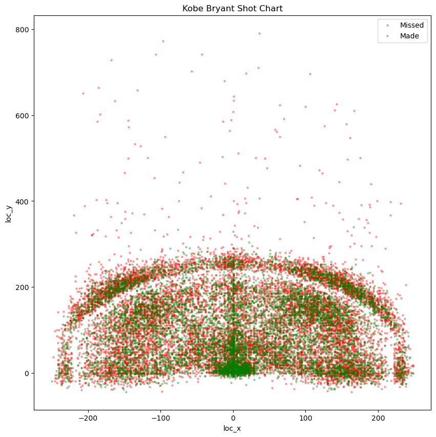
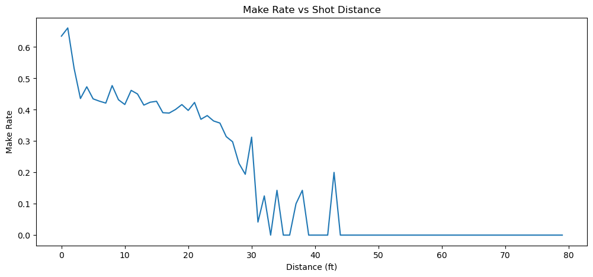
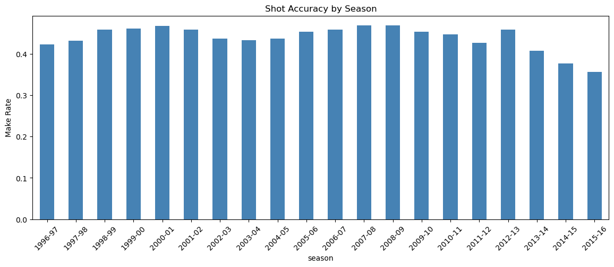

# Kobe Bryant Shot Selection

Predicting whether a Kobe Bryant field goal attempt went in (`shot_made_flag`), using the circumstances of the shot: shot type, location, distance, game situation and opponent. The data covers his 20-season NBA career (30,697 shots) and comes from the Kaggle "Kobe Bryant Shot Selection" dataset.

**Final model:** XGBoost with engineered features, **67.9% validation accuracy, F1 = 0.557** (F1 is for the "made" class).

## Results

Stratified 80/20 split (20,557 train / 5,140 validation rows, fixed `random_state=42`).

| Model | Val accuracy | Val F1 | Notes |
|---|---|---|---|
| Logistic Regression (scaled) | 0.675 | 0.555 | Linear baseline |
| Random Forest (manually tuned) | 0.677 | 0.558 | `max_depth=8`, `min_samples_leaf=15` |
| Random Forest (GridSearchCV) | 0.676 | 0.557 | `max_depth=10`, `min_samples_leaf=20`, 200 trees |
| XGBoost | 0.677 | 0.556 | `max_depth=4`, `learning_rate=0.1` |
| **XGBoost + engineered features** | **0.679** | **0.557** | Adds `seconds_left_in_period`, `is_home`, `is_clutch`, `shot_angle` |

**How to read this honestly:**
- Always predicting "missed" scores 0.554 accuracy, so the models add about 12 to 13 points.
- The five models are separated by only 0.4 points. On a 5,140-row validation set the standard error of accuracy is about 0.65 points, so **the ranking between models is within noise**. Logistic Regression is an equally defensible choice if interpretability matters.
- All model families (linear, bagging, boosting) land in the same 67 to 68% range. Published write-ups on this dataset report a similar range, which suggests the limit is the information in the data (defender position, shot arc and fatigue are not recorded), not the modelling.

## Key findings

- **Shot type is the strongest signal.** `action_type` and `combined_shot_type` have the highest feature importance. Make rate ranges from 93% for dunks to 35% for tip shots.
- **Distance matters:** make rate falls from about 62% in the restricted area to roughly 33 to 37% from three-point zones.
- **Clutch shots were harder:** 39.6% in the last 3 minutes of the 4th quarter or overtime, against 44.6% overall.
- **Season trend:** make rate was steady around 42 to 47% for most of his career, then dropped in his final three seasons (to about 36% in 2015-16).





## Approach

1. **Target handling:** 5,000 rows have a missing `shot_made_flag`. This is how the dataset withholds a prediction set, not a data-quality issue. They are never used for training or scoring, only for the final predictions.
2. **EDA** on the 25,697 labelled rows: class balance, make rate by shot type, zone, season and distance, shot chart, correlations.
3. **Feature selection:** dropped redundant location columns (`lat`/`lon` duplicate `loc_x`/`loc_y`), binned zone columns, row identifiers and zero-variance team columns.
4. **Encoding:** one-hot for Logistic Regression, label encoding for tree models.
5. **Modelling:** Logistic Regression, Random Forest (overfit at about 99.99% train accuracy, then constrained), GridSearchCV scored on F1, XGBoost.
6. **Feature engineering:** seconds left in period, home/away (from `matchup`), clutch flag, shot angle.

## Limitations

- **Accuracy and F1 on hard predictions only.** The original Kaggle competition for this dataset was scored on log loss using predicted probabilities. This project does not report log loss or calibration, so it is not comparable to that leaderboard.
- **Random split.** Shots from the same game and season appear in both train and validation. A time-based split would give a more conservative estimate.
- **Label encoding of nominal categories** (`action_type`, `opponent`) imposes an arbitrary order. Trees tolerate this, but target or one-hot encoding could be tested.
- **Final-prediction encoding.** For the 5,000 unlabelled shots, the label encoders are re-fit on the labelled and unlabelled categories combined. If a category appears only in the unlabelled rows, the integer codes could differ from those used in training. Fitting the encoders on the training data alone and handling unseen categories explicitly would be safer. There is no ground truth for those rows, so the effect cannot be measured.
- **Small differences between models** are within sampling noise (see above).

## Repository structure

```
notebooks/kobe_shot_selection.ipynb   full analysis, outputs included
images/                               figures used in this README
data/raw/README.md                    how to get the data
requirements.txt
```

## Reproduce

1. Download `data.csv` from the [Kaggle Kobe Bryant Shot Selection dataset](https://www.kaggle.com/c/kobe-bryant-shot-selection/data) and place it in `data/raw/`. See `data/raw/README.md`.
2. `pip install -r requirements.txt`
3. Run `notebooks/kobe_shot_selection.ipynb` from the `notebooks/` folder. It writes `final_predictions.csv` at the end.

## Tech stack

Python, pandas, NumPy, scikit-learn, XGBoost, matplotlib, seaborn

## License

MIT. See [LICENSE](LICENSE).
